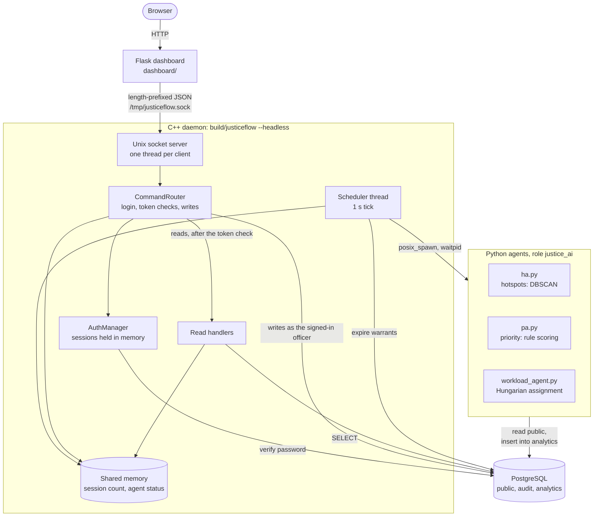
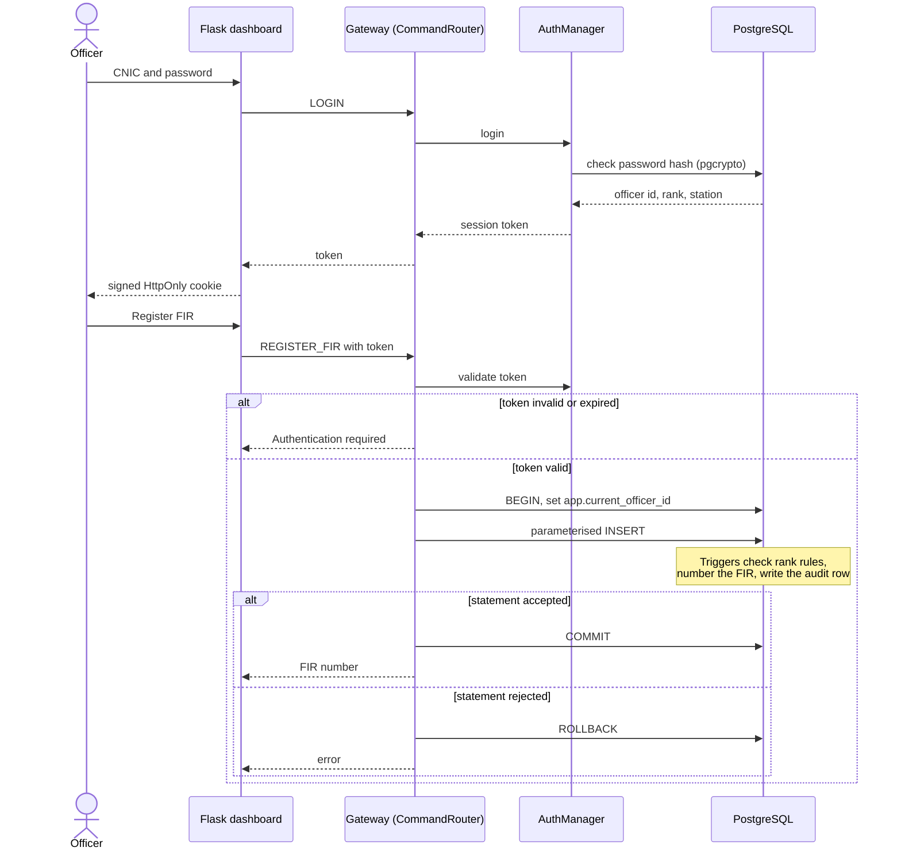
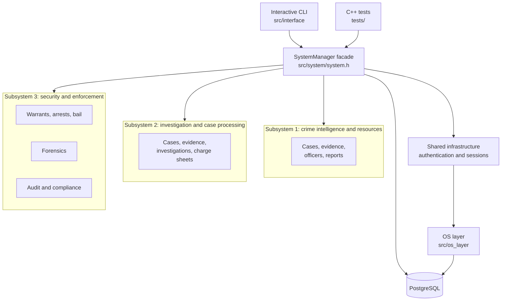

# ⚖️ JusticeFlow

> **A legal-grade Police Case & Evidence Management System** — a multi-course semester project integrating Database Management Systems, Software Design & Architecture, Artificial Intelligence, and Operating Systems into one cohesive platform.

---

## 📌 Project Overview

JusticeFlow is a full-stack, multi-disciplinary system for managing police cases, evidence, warrants, arrests, and officer duties. It demonstrates real-world integration of four core CS disciplines:

| Course | Integration |
|--------|------------|
| **DBMS** | PostgreSQL schema with audit triggers, ACID transactions, stored procedures, and role-based permissions |
| **SDA** | 5 applied design patterns (Strategy, Observer, Repository, Singleton, Template Method), full UML documentation |
| **AI** | Crime hotspot detection (DBSCAN), case priority scoring (rules), and officer workload assignment (Hungarian algorithm) |
| **OS** | Privilege daemon, IPC (Unix sockets, shared memory, FIFOs), thread pool, mmap, process synchronization |

---

## ✅ Current Status

The demo path runs end to end. `./run_justiceflow.sh` starts it and `make smoke` checks it: an officer signs in, registers an FIR, attaches evidence and issues a warrant; the daemon expires the warrant when its date passes; the three AI agents refresh hotspots, case priorities and workload suggestions; every change lands in an audit log that names the officer and cannot be altered by the application. The dashboard shows all of it and talks only to the daemon.

**Known gaps**

- The daemon tries to record logins and logouts in a `sessions` table that the schema does not create. Sign-in still works because sessions are held in memory, and the daemon log shows `relation "sessions" does not exist`.
- The Subsystem 1, 2 and 3 classes are not on the dashboard's request path (see [Subsystem design](#subsystem-design)).

[`docs/END_TO_END_REPORT.md`](docs/END_TO_END_REPORT.md) records the earlier end-to-end work and what it left open. It is a snapshot: where it differs from this README (for example on log locations and unit tests), this README is current.

---

## 🏗️ Architecture

### Running system



The daemon connects to PostgreSQL as `justice_app`. The dashboard has no database connection. The socket is readable only by its owner, so the daemon and dashboard run as the same user.

### How a request flows



The gateway commands are: `PING`, `LOGIN`, `LOGOUT`, `WHOAMI`, `GET_ACTIVE_SESSIONS`, `GET_AGENT_STATUS`, `GET_AGENT_STATUS_BY_INDEX`, `GET_CASE_LIST`, `GET_CASE_BY_ID`, `GET_HOTSPOT_DATA`, `GET_PRIORITY_CASES`, `GET_OFFICER_WORKLOAD`, `REGISTER_FIR`, `ADD_EVIDENCE`, `GET_CASE_EVIDENCE`, `ISSUE_WARRANT` and `GET_CASE_WARRANTS`.

### Subsystem design

This is the modular design built for the SDA course. The interactive CLI (starting the binary without `--headless`) and the C++ tests use it. The gateway implements its commands directly and does **not** go through these subsystems.



Some of these classes query tables or schemas that do not exist; the end-to-end report lists the details.

---

## 📁 Repository Structure

```
justiceflow/
├── dashboard/               # Flask web interface; talks only to the daemon
│   ├── app.py               # Routes
│   ├── run.py               # Entry point (127.0.0.1:5000; JF_DASHBOARD_HOST/PORT)
│   ├── client/gateway.py    # Unix-socket client
│   ├── templates/  static/
│   └── legacy/              # Old Streamlit prototype; unused
├── db/
│   ├── schema/              # 00-06 SQL files and schema_patch.sql
│   └── data_generator/      # Synthetic data (officers get password justice123)
├── src/
│   ├── main.cpp             # Daemon and CLI entry point
│   ├── api_gateway/         # Socket gateway: login, token checks, write commands
│   ├── interface/           # Interactive CLI
│   ├── common/              # Shared structs, constants, DB config, logger
│   ├── ai_agents/           # ha.py, pa.py, workload_agent.py
│   ├── os_layer/            # scheduler, ipc, threading, memory, process
│   └── system/
│       ├── system.h/.cpp    # SystemManager facade
│       ├── shr_infra/auth/  # Authentication and sessions
│       ├── subsystem1/
│       ├── subsystem2/      # controllers, models, patterns
│       └── subsystem3/      # audit, enforcement, forensic
├── tests/                   # C++ tests, fixtures.sql, smoke_test.py
├── scripts/                 # demo.sh (start/stop), common.sh (shared prompts)
├── docs/                    # UML diagrams, proposals, reports
├── logs/                    # Created at run time
├── run_justiceflow.sh       # Set up, build and start everything
├── install.sh               # Install, build and test
├── justiceflow_setup.sh     # Ubuntu system packages
├── run_ai_agents_standalone.sh
├── Makefile
└── requirements.txt
```

---

## ⚙️ Prerequisites

### System
- Ubuntu 22.04+ (the scripts use `apt`)
- A C++17 compiler (`g++`)
- GNU Make
- `libreadline-dev`, and `libgtest-dev` for the tests
- PostgreSQL 14+

### Python
- Python 3.10+
- pip packages listed in `requirements.txt`

### C++ Libraries
- `libpq-dev` — PostgreSQL C client
- `libpthread` — POSIX threads (part of glibc)

---

## 🚀 Getting Started

### 1. Clone the Repository

```bash
git clone https://github.com/Furqan-2006/JusticeFlow.git
cd JusticeFlow
```

### 2. Run it

On Ubuntu, from the project folder, as your normal user:

```bash
./run_justiceflow.sh          # installs what is missing, sets up, builds, starts
./run_justiceflow.sh stop
```

It asks for a PostgreSQL admin user (it can create one for your Linux account), a dashboard port, and before erasing an existing database. Python packages go into `.venv`.

Both `run_justiceflow.sh` and `install.sh` save their output in `logs/`, in files named with the start time. The database reset, build, daemon and dashboard logs from each start go there too.

To install everything and also run the tests, use `./install.sh` (`--seed-data` fills a new database with demo data; `--help` lists the options). It calls `justiceflow_setup.sh` with `sudo` for the system packages.

The same stack can be driven through `make`, with `PGUSER` naming a PostgreSQL superuser (default: your Linux username, over the local socket; for another account also set `PGHOST=localhost PGPASSWORD=...`):

```bash
make setup-python                       # .venv with the agents' and dashboard's packages
make demo                               # reset DB, build, start daemon + dashboard
make smoke                              # walk the demo story and check every step
make demo-stop
```

`make demo` **drops and recreates** the `justiceflow` database from `db/schema/`, seeds about 22,000 synthetic rows (150 officers, all with the password `justice123`), builds the daemon, and starts it and the dashboard at `http://localhost:5000`. It prints a CNIC to sign in with. Set `JF_KEEP_DB=1` to keep the existing data. The daemon and agents use the development passwords of the roles the schema creates; set `JF_DB_PASS` and `JF_AI_DB_PASS` to override them.

### 3. The demo story

Sign in as an Inspector, then:

1. **Register an FIR** from the Cases page. It gets a generated FIR number.
2. **Attach evidence** on the case page. It gets an evidence number.
3. **Issue a warrant** on the same page (Inspector rank or above).
4. **Warrant expiry:** the daemon expires warrants whose `valid_until` date has passed. Dates are whole days, so to see this live, move one back as the database admin, for example `UPDATE warrants SET issue_date = CURRENT_DATE - 3, valid_until = CURRENT_DATE - 1 WHERE warrant_number = '...'`. Within 5 seconds (the interval `make demo` sets) it shows as Expired.
5. **AI agents:** the AI Analytics, Workload and AI Agents pages fill in a few seconds after start as the agents run.
6. **Audit trail:** every change is recorded in `audit.audit_log` with the officer's id and belt number, and the application role cannot alter or delete those rows.

### 4. Running the pieces by hand

```bash
make db-reset                           # needs the PG* admin variables above
make build

# daemon (headless: serves the gateway until SIGTERM/SIGINT)
export JF_DB_HOST=127.0.0.1 JF_DB_USER=justice_app JF_DB_PASS=<justice_app password>
export JF_AI_DB_PASS=<justice_ai password>
./build/justiceflow --headless --pid-file /tmp/justiceflow.pid

# dashboard (in a second terminal, from the project folder)
source .venv/bin/activate
cd dashboard && python3 run.py
```

Sign in with an officer's CNIC and password (the seeded officers all use `justice123`). The daemon verifies the credentials, issues a session token, and checks it on every data request. Set `JF_DASHBOARD_SECRET` to keep dashboard logins across restarts. After five wrong passwords a CNIC is locked for five minutes.

### Background jobs

While it runs, the daemon expires warrants whose `valid_until` date has passed (every 30 s) and runs the three AI agents (hotspot, priority, workload) every 5 minutes, the first run a few seconds after start. The agents connect as the `justice_ai` role, so give the daemon its password and the agent location:

```bash
export JF_AI_DB_PASS=<justice_ai password>
export JF_AGENT_SCRIPT_DIR=$PWD/src/ai_agents   # default: src/ai_agents relative to where you start it
# optional: JF_AGENT_INTERVAL_S (300), JF_EXPIRE_INTERVAL_S (30), JF_AI_DB_HOST / JF_AI_DB_NAME / JF_AI_DB_USER
```

An agent's status on the AI Agents page is 0 for a successful last run; otherwise it is the agent's exit code (124 means it timed out) with the reason beside it.

---

## 🎓 Course Integration Details

### Database Management Systems (DBMS)
- Full normalized schema across `public`, `audit`, and `analytics` namespaces
- ACID-compliant transactions enforced at application and DB level
- Audit triggers with `SECURITY DEFINER` and immutability enforcement
- Scheduled SQL jobs for warrant/bail expiry and analytics logging
- Role-based permissions with least-privilege enforcement

### Software Design & Architecture (SDA)
- **Strategy Pattern** — `ICaseStatusStrategy` for pluggable case state transitions
- **Observer Pattern** — `IEvidenceObserver` for evidence state change notifications
- **Repository Pattern** — `forensic_repository` as a pure DB-access abstraction layer
- **Singleton Pattern** — `audit_manager` as the single controlled audit entry point
- **Template Method Pattern** — `audit_query` for parameterized query construction
- UML class, sequence, and component diagrams in `docs/`

### Artificial Intelligence
- **Crime Hotspot Analyzer** (`ha.py`) — geospatial crime cluster detection (DBSCAN)
- **Case Priority Recommender** (`pa.py`) — rule-based case urgency scoring
- **Officer Workload Balancer** (`workload_agent.py`) — assignment with the Hungarian algorithm

### Operating Systems

Used by the running daemon:
- **Scheduler** — a one-second ticker thread running warrant expiry and the agents
- **IPC** — a Unix domain socket and an `mmap`-backed shared status table
- **Process management** — agents started with `posix_spawn`, reaped with `waitpid`, killed on timeout
- **Memory safety** — the password buffer is pinned with an `mlock` RAII guard during login

Implemented but not started by the daemon:
- Double-fork daemonisation (`daemon.cpp`), the SIGALRM timer, the thread pool and connection gate, named FIFOs

---

## 🧪 Running Tests

`make smoke` (with the stack running, see above) is the end-to-end check: it signs in, registers an FIR, adds evidence, issues a warrant, waits for the daemon to expire it and for the agents to run, checks the audit trail and that the application role cannot change it, then confirms the dashboard shows the result.

The C++ unit and integration tests use their own `justiceflow_test` database, never the application one:

```bash
make test-db                            # (re)create justiceflow_test; needs the PostgreSQL superuser
make test                               # all tests
make auth_test                          # or one module; `make list-tests` shows them
```

---

## 🔐 Security Notes

- Pass database credentials through environment variables. The schema does create `justice_app` and `justice_ai` with development passwords equal to their names; change them on anything but a throwaway machine.
- `auth_manager` uses `mlock` to prevent sensitive memory from being paged to disk.
- Session tokens are UUID-based, generated from OS randomness. Sessions are held in the daemon's memory and are lost when it restarts.
- Every data request and every write carries a session token, checked by the gateway's `CommandRouter` before anything runs. Writes execute as the signed-in officer, so the audit log names the person who acted.
- Failed logins return one generic message and are throttled per CNIC.
- The dashboard keeps the token in a signed, HttpOnly cookie and never opens a database connection.

---

## 👥 Team

| Name | Responsibility |
|------|---------------|
| Furqan | Subsystem 3, Authentication module, OS Scheduler (control plane) — daemon, timer, job executor, process spawner |
| Abdullah | Subsystem 2, Flask Dashboard, OS IPC (data plane) — Unix socket, FIFO, shared memory, domain socket listener |
| Abu Bakar | Subsystem 1, Flask Dashboard, OS Threading (execution layer) — thread pool, worker, session manager, sync |

---

## 📝 License

This project was developed as a university semester project. All rights reserved by the contributing team members.
